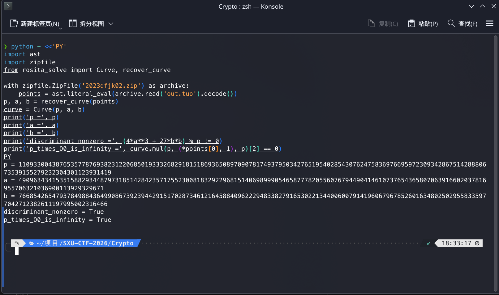

# 2026 山西大学网络安全 CTF 校赛 | 新星赛道

- WriteUp 文档仓库: [https://github.com/yangnuozhen/sxu-ctf-2026-writeup](https://github.com/yangnuozhen/sxu-ctf-2026-writeup)
- 包含题目: 
    - Crypto: 1, 2, 3
    - Misc: 2, 3
    - Pwn: 1, 2
    - Reverse: 2, 3
    - Web: 1, 2, 3

> 由于部分题目的靶机在比赛结束后无法连接，故部分复现截图缺失...

## Crypto 方向

### 01.关键的Vigenere

#### 初步分析

题目明确给出了维基尼亚密码 Vigenere，提示里亦给出了 Keyword ，也就是关键词替换密码。故考虑两种密码。

注意到下方的 `qzsz{bl@rstpb_ibgfrg!}` 显然是 Flag 的结构，故仅替换英文字母，其他字符原样保留。然后假设前四个字母 `qzsz` 对应 `flag`，反推得密钥的前四个字母为 `LOST`。

又云「观其表，解其里」，更合适的切入点是先构造关键词替换表，解开上方短句中的提示。

#### Keyword 解密

尝试使用关键的 `VIGENERE` 作为关键词，得到

```plain
明文字母表：ABCDEFGHIJKLMNOPQRSTUVWXYZ
密文字母表：VIGENRABCDFHJKLMOPQSTUWXYZ
```

进一步，解密上方短句，得 `KEY IS LOSTDREAM`。

太好了这就是 key 大人。这和我们先前注意到的结果一致。

#### Vigenere 解密

使用标准 Vigenere 解密，将密钥 `LOSTDREAM` 循环使用，并将非字母符号在加密过程中丢弃，最后原样保留。

得到

```plain
flag{yu@nshen_qidong!}
```

**原神启动！**

### 02. Hidden Key

#### 初步分析

源码给了密文和泄露值: 

```py
# [140, 96, 112, 178, 38, 180, 158, 240, 179, 202, 251, 138, 188, 185, 23, 67, 163, 22, 150, 18, 143, 212, 93, 87, 209, 139, 92, 252, 55, 137, 6, 231, 105, 12, 65, 59, 223, 25, 179, 101, 19, 215]
# 2669175714787937
```

注意到 L17 将 `key` 按大端序解释为整数，右移 12 位后打印，高 52 位已经清晰可见。这样 64 位密钥只剩 12 位未知。也就是只需要枚举 $2^{12}=4096$ 个候选密钥。

#### 枚举

具体流程如下：

1. 令 `low` 遍历 `0..4095`，拼接得到完整 64 位候选密钥。
2. 计算候选 key 的 MD5 整数种子。
3. 按原题调用顺序生成密钥流，并逐项异或解密。
4. 筛选全部为可打印 ASCII、以 `flag{` 开头且以 `}` 结尾的候选。
5. 使用找到的 key 重新生成完整密文，逐项与附件中的 42 个整数比较。
6. 再检查恢复 key 右移 12 位后的结果等于原题泄露值。

脚本见 [hidden_key_solve.py](./assets/hidden_key_solve.py)

得到密钥：

```text
key，十六进制：97b99e652b261b77
低 12 位：0xb77
```

以及 Flag:

```plain
flag{e319a58c-4dd6-4e6a-a3fb-f4b0d339faba}
```

###  03. Rosita

#### 初步分析

分析加密脚本，源码先在未知曲线上随机选择三个点 $R,E,C$，此后三个点保持不变。每次取一个明文字节，构造随机填充消息 `m`，再生成 16 字节 `nonce`，并计算：

$$
Q_i=m_iR+n_iE+h_iC,
$$

其中：

$$
n_i=\operatorname{bytes\_to\_long}(\mathrm{nonce}_i),
$$

$$
h_i=\operatorname{bytes\_to\_long}
\left(\operatorname{SHA256}(\mathrm{nonce}_i\parallel\mathrm{m}_i)\right).
$$

已知的是 73 个输出点 $Q_i$。曲线的 $p,a,b$、三个固定点和每轮随机值均未知。

#### 恢复曲线

短 Weierstrass 曲线方程为：

$$
y^2\equiv x^3+ax+b\pmod p.
$$

对每个输出点定义普通整数：

$$
t_i=y_i^2-x_i^3.
$$

因此：

$$
t_i\equiv ax_i+b\pmod p.
$$

选取前两个点作为基准，得到：

$$
t_1-t_0\equiv a(x_1-x_0)\pmod p,
$$

$$
t_i-t_0\equiv a(x_i-x_0)\pmod p.
$$

交叉相乘并相减，可以同时消去 $a$ 和 $b$：

$$
D_i=(t_i-t_0)(x_1-x_0)-(t_1-t_0)(x_i-x_0).
$$

每个 $D_i$ 都是 $p$ 的整数倍，因此：

$$
p\mid\gcd(D_2,D_3,\ldots).
$$

哦对了，GCD 不一定恰好等于 $p$，也可能多出小的公因子。本题实际得到的是 $4p$。去掉因子 4 后，得到一个 512 位素数。

确定 $p$ 后，利用模逆恢复：

$$
a=(t_1-t_0)(x_1-x_0)^{-1}\bmod p,
$$

$$
b=t_0-ax_0\bmod p.
$$

本题参数为：

```text
p = 11093300438765357787693823122068501933326829181518693650897090781749379503427651954028543076247583697669597230934286751428880673539155279232304301123931419

a = 490963434153515882934487973185142842357175523008183292296815140698999054658777820556076794490414610737654365807063916602037816955706321036900113929329671

b = 7668542654793784988436499086739239442915170287346121645884096222948338279165302213440060079141960679678526016348025029558335977042712382611197995002316466
```

#### 验证异常曲线条件

下面验证 $[p]Q_0=\mathcal O$ 。

对第一个输出点做标量乘法，实际结果为：

$$
[p]Q_0=\mathcal O.
$$

由于 $Q_0$ 是一个有坐标的非无穷远点，而 $p$ 是素数，$Q_0$ 的阶只能是 $p$。因此：

$$
p\mid\#\mathcal E(\mathbb F_p).
$$

另一方面，Hasse 界给出：

$$
p+1-2\sqrt p\le\#\mathcal E(\mathbb F_p)
\le p+1+2\sqrt p.
$$

对于本题的 512 位素数，区间中唯一的正整数 $p$ 倍数就是 $p$ 本身，所以：

$$
\#\mathcal E(\mathbb F_p)=p.
$$

这是异常曲线，也等价于 Frobenius 迹为 1。此时可以使用 Smart attack，将椭圆曲线离散对数问题转到加法群。参考 [Generating Anomalous Elliptic Curves，第 2 节](https://www.monnerat.info/publications/anomalous.pdf)。

参数验证：


接下来做 Smart attack 中的映射。

为避免依赖完整 SageMath 环境，最终脚本使用 Python 大整数，在模 $p$ 和模 $p^2$ 下实现 Jacobian 坐标的点运算。

对曲线点 $P=(x,y)$，保持 $x$ 不变，令提升后的纵坐标为：

$$
\widetilde y=y+pk.
$$

将曲线方程展开到模 $p^2$：

$$
y^2+2ypk\equiv x^3+ax+b\pmod{p^2}.
$$

由于原来的点在模 $p$ 下满足方程，$x^3+ax+b-y^2$ 可以被 $p$ 整除，因此可取：

$$
k=\frac{x^3+ax+b-y^2}{p}\,(2y)^{-1}\bmod p.
$$

在本题中，这样即可把点提升到所选整数系数曲线的模 $p^2$ 点。计算 $[p]\widetilde P$，使用无穷远点附近的形式参数：

$$
t=-\frac{x}{y}.
$$

若 $[p]\widetilde P$ 的 Jacobian 坐标为 $(X:Y:Z)$，对应仿射坐标为 $x=X/Z^2,y=Y/Z^3$，所以：

$$
t=-\frac{XZ}{Y}.
$$

此时 $Z$ 能被 $p$ 整除，$Y$ 在模 $p$ 下非零。定义：

$$
\lambda(P)=\frac{t([p]\widetilde P)}p\bmod p
=-X\frac ZpY^{-1}\bmod p.
$$

在本题所用提升下，该映射非零，并满足加法关系。它会把原始加密式映射成：

$$
\lambda(Q_i)=m_i\lambda(R)+n_i\lambda(E)+h_i\lambda(C)\pmod p.
$$

于是无需预先知道 $R,E,C$，也能把 73 个输出点都转成已知标量。记：

$$
d_i=\lambda(Q_i).
$$

该实现针对本题附件验证有效。对其他异常曲线，所选提升可能导致映射为零，需考虑调整曲线系数的 $p$ 倍项后重新提升。

#### 利用填充方式建立短向量关系

题目使用：

```python
urandom(8) + m + b'\x00' * (ZZ(p).nbits() // 8 - len(m) - 8 - 1)
```

恢复出 $p$ 后，已知其位长是 512，所以：

```text
512 // 8 = 64
```

本题实际明文均为 ASCII，`chr(flag[i]).encode()` 每次产生 1 字节。因此零填充长度为：

$$
64-1-8-1=54\text{ 字节}.
$$

完整消息字节串的结构是：

```text
8 字节随机前缀 || 1 字节字符 || 54 字节零
```

消息总长为 63 字节，而不是 64 字节。设随机前缀对应整数 $r_i<2^{64}$，字符字节为 $f_i<256$，则：

$$
m_i=(256r_i+f_i)\,2^{54\times8}
=(256r_i+f_i)\,2^{432}.
$$

定义：

$$
u_i=256r_i+f_i,\qquad 0\le u_i<2^{72}.
$$

所以，原来看起来接近 504 位的消息整数，实际上只包含一个不超过 72 位的变量，其余部分是固定的 $2^{432}$ 因子。

接下来将固定因子并入未知系数。

令：

$$
\alpha=2^{432}\lambda(R),\quad
\beta=\lambda(E),\quad
\gamma=\lambda(C)\pmod p.
$$

原式变为：

$$
d_i\equiv\alpha u_i+\beta n_i+\gamma h_i\pmod p.
$$

三类未知数的大小分别为：

| 变量 | 来源 | 每项大小 |
| --- | --- | --- |
| $u_i$ | 8 字节前缀与 1 字节字符 | 小于 $2^{72}$ |
| $n_i$ | 16 字节 nonce | 小于 $2^{128}$ |
| $h_i$ | SHA-256 输出 | 小于 $2^{256}$ |

这里没有对 SHA-256 求原像。攻击仅将哈希输出视作一个有已知上界的整数，利用它与其他两类整数共同乘以固定系数的线性结构。

将 73 组数据写成向量：

$$
\boldsymbol d\equiv
\alpha\boldsymbol u+\beta\boldsymbol n+\gamma\boldsymbol h\pmod p.
$$

这就形成了一个隐藏格问题：已知一个模 $p$ 的线性组合，试图恢复其背后的低秩短向量空间。参考 [The Hidden Lattice Problem](https://eprint.iacr.org/2021/1491.pdf)。

#### 第一次 LLL: 寻找共同正交关系


考虑格：

$$
L=\{\boldsymbol w\in\mathbb Z^{73}:
\langle\boldsymbol w,\boldsymbol d\rangle\equiv0\pmod p\}.
$$

本题 $d_0\ne0$，所以 $d_0$ 在模 $p$ 下可逆。令：

$$
c_i=-d_id_0^{-1}\bmod p.
$$

可以构造下面这个 73 维行基矩阵：

$$
B=\begin{pmatrix}
p&0&0&\cdots&0\\
c_1&1&0&\cdots&0\\
c_2&0&1&\cdots&0\\
\vdots&\vdots&\vdots&\ddots&\vdots\\
c_{72}&0&0&\cdots&1
\end{pmatrix}.
$$

第一行与 $\boldsymbol d$ 的内积为 $pd_0$，其余第 $i$ 行的内积为 $c_id_0+d_i$，均为 $p$ 的倍数，所以这些行都属于 $L$。矩阵行列式绝对值为 $p$，也与该模正交条件的指数一致。

对它执行：

```python
LLL.reduction(B, delta=0.99)
```


由隐藏向量关系，对任意 $\boldsymbol w\in L$ 有：

$$
\alpha\langle\boldsymbol w,\boldsymbol u\rangle+
\beta\langle\boldsymbol w,\boldsymbol n\rangle+
\gamma\langle\boldsymbol w,\boldsymbol h\rangle
\equiv0\pmod p.
$$

如果 $\boldsymbol w$ 很短，则上式中的三个整数内积也受限。对随机的固定系数，这些受限内积不容易形成额外的非零模关系；共同满足三个整数内积均为零的向量，成为可优先寻找的短向量：

$$
\langle\boldsymbol w,\boldsymbol u\rangle=
\langle\boldsymbol w,\boldsymbol n\rangle=
\langle\boldsymbol w,\boldsymbol h\rangle=0.
$$

本题三条隐藏向量在 73 维空间中张成 3 维空间，其共同正交空间应为 $73-3=70$ 维。实际 LLL 输出也出现了清晰分层：

- 前 70 行的最大绝对元素位长为 7 或 8 位。
- 最后 3 行的最大绝对元素位长分别为 15、16、16 位。
- 短行矩阵的实际秩为 70。

因此取前 70 行，组成 $70\times73$ 的整数矩阵 $W$，作为共同正交关系的候选基。

#### 整数核 & 第二次 LLL

目标空间为：

$$
K=\{\boldsymbol v\in\mathbb Z^{73}:W\boldsymbol v=0\}.
$$

如果前一步恢复正确，原始 $\boldsymbol u,\boldsymbol n,\boldsymbol h$ 都应位于这个 3 维整数核中。

这里需要整数核，而不只是一个任意缩放的有理零空间基。有理基逐行清分母后虽然仍然处于零空间内，却可能只生成完整整数核的真子格，导致原本的短向量难以恢复。

脚本采用 FLINT 的 HNF 变换：

```python
H, T = fmpz_mat(W).transpose().hnf(transform=True)
```

满足：

$$
H=T W^T.
$$

这里 $T$ 是整数幺模变换矩阵。因为 $W$ 的秩为 70，HNF 最后 3 行为零，$T$ 中相应的 3 行就给出了整数核的基。通过这种方式保留的是完整、饱和的整数核。

对恢复的 3 行整数核基再次执行 LLL。原始三类向量的逐项大小约为 72、128、256 位，差异很大，因此最短的消息向量有机会被单独分离出来。

本题第二次约简实际得到的三个基向量，最大绝对元素位长分别为：

```text
[72, 128, 256]
```

最短向量就是所需的 $\boldsymbol u$，可能存在整体正负号歧义。脚本同时尝试正负号，并要求恢复出的 $u_i$ 均处于 `[0, 2**72)`，低字节全部为可打印 ASCII。

#### 提取字符

根据定义：

$$
u_i=256r_i+f_i,
$$

所以：

$$
f_i=u_i\bmod256.
$$

逐项取低 8 位并转换为字节串，得到：

```text
Congratulations! Your flag is: flag{893d041e-c0a2-3145-5320-cdee7d3c87fb}
```

#### 解题脚本

多亏了 gpt-6.1-sol，复现脚本不需要装雷霆大 SageMath。只需要依赖：

```bash
python -m pip install sympy fpylll cysignals python-flint
```

完整脚本见 [rosita_solve.py](./assets/rosita_solve.py)。

